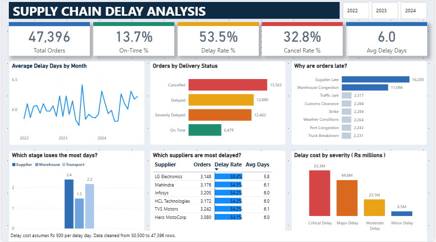

# Supply Chain Delay Analysis

A Power BI dashboard built on 47,396 supply chain orders to find out why so many deliveries are late and how much the delays cost.



## Why I did this

A company ships a lot of orders, and many of them reach the customer late. Management wanted to know three things: how bad the delay problem is, what is causing it, and what it costs. I took a messy file of about 50,000 orders (2022 to 2024), cleaned it, and built a one-page dashboard to answer these questions.

The problem statement is in `Supply chain problem statement.docx` and the full write-up is in [REPORT.pdf](REPORT.pdf).

## What I found

- Only **13.7%** of orders arrived on time.
- **53.5%** were delayed or severely delayed, and **32.8%** were cancelled.
- The average delay is **6.0 days**.
- **Late suppliers** (16,200 orders) and **warehouse congestion** (11,094 orders) cause 67% of the delays that have a recorded reason.
- The estimated delay cost is **Rs 142.7 million**, and critical and major delays make up about 79% of it.

### Delivery status

| | Status | Orders | Share |
|---|---|---|---|
| 🟢 | On time | 6,479 | **13.7%** |
| 🟡 | Delayed | 12,890 | **27.2%** |
| 🟠 | Severely delayed | 12,462 | **26.3%** |
| 🔴 | Cancelled | 15,565 | **32.8%** |
| | **Total** | **47,396** | **100%** |

Other headline numbers: average delay **6.0 days**, total delay cost **Rs 142.7 million** (estimate).

### Where the days are lost

On average a delayed order loses 2.4 days at the supplier, 2.2 days in transport and 1.5 days in the warehouse.

| Stage | Average days lost |
|---|---|
| 🔴 Supplier | **2.4** |
| 🟠 Transport | 2.2 |
| 🟡 Warehouse | 1.5 |

### It is not just one supplier

The six most delayed suppliers are very close to each other, so removing one supplier will not fix the problem.

| Supplier | Orders | Delay rate | Average delay (days) |
|---|---|---|---|
| LG Electronics | 3,148 | 56.4% | 5.8 |
| Mahindra | 3,176 | 54.5% | 6.1 |
| Infosys | 3,205 | 54.2% | 6.0 |
| HCL Technologies | 3,172 | 54.2% | 6.0 |
| TVS Motors | 3,242 | 54.2% | 6.1 |
| Hero MotoCorp | 3,080 | 54.1% | 6.0 |

### Most of the money is in the biggest delays

| | Severity | Cost (Rs million) | Share |
|---|---|---|---|
| 🔴 | Critical | 63.3 | **44%** |
| 🟠 | Major | 49.8 | **35%** |
| 🟡 | Moderate | 23.1 | **16%** |
| 🟢 | Minor | 6.5 | **5%** |
| | **Total** | **142.7** | **100%** |

## What I would recommend

| Priority | Action | Why |
|---|---|---|
| 🔴 1 | Agree fixed delivery dates with all suppliers and track them every month | Biggest cause (16,200 orders), and no single supplier stands out, so dropping one will not solve it |
| 🟠 2 | Reduce congestion in the warehouse | Second biggest cause (11,094 orders) and the company can control it |
| 🟡 3 | Focus first on critical and major delays | They hold most of the cost |
| 🟢 4 | Look into the cancelled orders separately | Largest group, but the data does not say why they happen |

## How I cleaned the data

The raw file had 50,500 rows with repeated order IDs, dates in different formats, the same status or reason spelled in different ways, and blank cells.

| Step | What I did |
|---|---|
| Duplicates | Removed repeated order IDs |
| Dates | Changed the mixed formats into one |
| Spellings | Made status, reason and supplier names consistent |
| Blanks | Handled empty cells column by column |
| Validation | Power BI removed 95 rows where the delay figures contradicted each other |

| Stage | Rows |
|---|---|
| Raw file | 50,500 |
| After cleaning in Excel | 47,491 |
| After validation in Power BI (used in the dashboard) | **47,396** |

## How I built it

- **Excel** for cleaning the data.
- **Power Query** to load the data and set the data types.
- **Data model:** a date table (`Dim_Date`) linked one-to-many to the orders table (`Fact_Orders`), so the Year buttons filter every chart.
- **DAX measures:** Total Orders, On-Time %, Delay Rate %, Cancel Rate %, Average Delay Days and Total Delay Cost.
- **Power BI** for the dashboard: five cards, six charts and a year slicer.

```DAX
Total Orders     = DISTINCTCOUNT(Fact_Orders[Order_ID])
On-Time %        = DIVIDE([On Time Orders], [Total Orders])
Delay Rate %     = DIVIDE([Delayed Orders], [Total Orders])
Avg Delay Days   = AVERAGE(Fact_Orders[Total_Delay_Days])
Total Delay Cost = SUM(Fact_Orders[Delay_Cost])
```

## What this analysis cannot tell you

- The delay cost is an estimate. I used a fixed Rs 500 per delay day, which is my assumption and not a figure from the company's accounts.
- The data has no reason for cancellations.
- The supplier table shows only the six highest delay rates.
- It looks at the past only. I did not forecast future delays.

## What I would do next

- Get the reasons for cancellations.
- Use the real cost per delay day instead of my assumption.
- Show every supplier, not only the top six.
- Forecast delays for the coming months.
- Add a drill-through page so a manager can click a supplier and see its orders.

## Files in this repository

| File | What it is |
|---|---|
| `REPORT.pdf` | Written project report |
| `Supply chain problem statement.docx` | The problem I was asked to solve |
| `supply_chain_50k_messy.xlsx` | Raw data (50,500 rows) |
| `cleaned_data.csv` | Cleaned data |
| `supply_chain_dashboard.pbix` | Power BI dashboard file |
| `dashboard.png` | Screenshot of the dashboard |

## How to open the dashboard

Download `supply_chain_dashboard.pbix` and open it in Power BI Desktop (free from Microsoft). If it asks for the data source, point it to `cleaned_data.csv`.

## About me
    Done By Varshini

- LinkedIn: [varshini-k](https://www.linkedin.com/in/varshini-k-4b27a0353)
- GitHub: [varshinikumar407-cmyk](https://github.com/varshinikumar407-cmyk)
- Email: varshinikumar407@gmail.com
